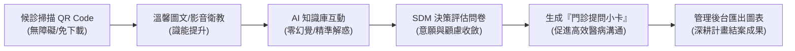
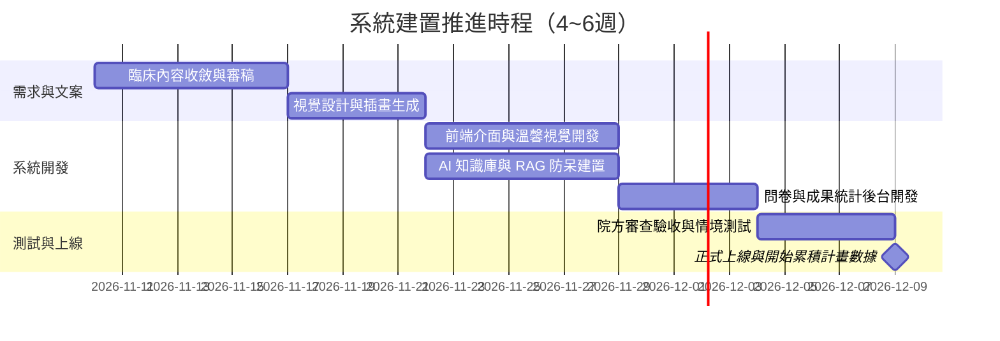

# 兒科次世代基因定序（NGS）智慧互動衛教系統
## 建置提案企劃書暨臨床合作需求訪談綱要

> **提案對象**：醫院兒科部 / 計畫主持團隊  
> **臨床指導**：兒童遺傳專科 王禹期醫師  
> **規劃執行**：系統整合與顧問團隊  
> **專案背景**：搭配「健康台灣深耕計畫」經費執行，落實兒科智慧醫療與精準醫療照護識能普及

---

## 執行摘要（Executive Summary）

次世代基因定序（NGS）技術日益成熟，在兒科罕見疾病、發展遲緩、遺傳代謝異常及小兒血液腫瘤的早期診斷中扮演關鍵角色。然而，臨床門診常面臨**「技術概念艱澀、家長焦慮抗拒、自費/給付範圍混淆、醫師衛教耗時冗長」**等痛點。

本專案規劃打造一套專為**兒科門診與候診情境量身設計的「行動化互動衛教 Web 系統」**。以溫馨手繪風格降低就醫焦慮，整合**視覺化導覽、檢索增強型 AI 諮詢小幫手（RAG 架構）**與**醫病共享決策（SDM）前後測機制**，並能產出符合深耕計畫管考規範的量化統計報表，達成「提升醫療品質、減輕醫師負擔、圓滿計畫成果」之三贏效益。

---

## 一、 專案定位與「健康台灣深耕計畫」效益對接

衛福部「健康台灣深耕計畫」核心聚焦於**提升兒科與重難罕症照護品質、智慧醫療落地普及、強化民眾健康識能**。本系統各模組均能對應具體的官方管考指標：

| 系統功能模組 | 臨床落地做法 | 對接深耕計畫管考亮點 / 成果效益 |
| :--- | :--- | :--- |
| **1. 溫馨圖像化衛教** | 手機互動式卡片解析 NGS 目的、採檢流程、給付與自費界線、檢測極限。 | **提升兒科健康識能**：將尖端基因醫療轉化為平易近人的數位教材，釋放醫師衛教時間。 |
| **2. 醫療檢索型 AI 小幫手** | 嚴格綁定科部審定題庫，即時解答費用、時程、安全疑慮，超出題庫一律引導向醫師諮詢。 | **智慧醫療創新落地**：展示生成式 AI 於臨床輔助之正向應用，減輕家長面對未知的焦慮。 |
| **3. 醫病共享決策（SDM）評估** | 前後測 3~5 題快速理解度評估，了解家長關鍵抗拒點（費用、侵入性、心理壓力）。 | **量化識能成效數據**：自動產出「衛教前後認知提升率（%）」，作為深耕計畫量化成效。 |
| **4. 診間提問摘要卡** | 完成衛教後自動彙整家長最關心的 2~3 個問題，截圖或出示手機給當診醫師。 | **落實精準醫療早期介入**：醫師 10 秒掌握家長核心疑慮，顯著提高醫病決策與轉介效率。 |
| **5. 計畫成果數據後台** | 統計點擊人次、停留時長、問卷反饋統計、高頻諮詢問題排行榜。 | **一鍵產出結案報告書附錄**：產出符合官方格式的圖表與數據，輕鬆完成期末審查核銷。 |

---

## 二、 系統架構與功能規劃

### 1. 病患端核心功能（Mobile Web，響應式免安裝）
* **免安裝即掃即看**：支援 iOS / Android 原生相機掃描 QR Code 開啟，無須下載任何 App。
* **首頁與主題引導**：
  * 「什麼是 NGS？與傳統基因檢測有何不同？」
  * 「檢測流程 3 步驟（抽血檢體 $\rightarrow$ 定序分析 $\rightarrow$ 專科醫師報告諮詢）」
  * 「誰適合做？健保給付 vs. 自費方案懶人包」
  * 「檢測的局限性與知情同意說明（避免後續認知落差）」
* **AI 衛教諮詢小幫手（RAG 架構）**：
  * **快捷標籤**：提供「費用多少？」、「需要禁食嗎？」、「多久知道報告？」、「健保有給付嗎？」等一鍵快答。
  * **自然語言自由發問**：家長可用白話提問，系統檢索官方知識庫給予回答。
  * **醫療防呆機制**：禁止提供個別病情診斷或用藥建議，超出範圍主動提示：「此問題涉及個體臨床狀況，建議稍後與主治醫師詳細討論」。
* **前後測與回饋問卷**：
  * 識能測驗：3 題簡單是非/選擇題，比對閱讀前與閱讀後的正確率。
  * 意願與顧慮盤點：單選或複選「目前最想了解的事項」。
* **個人化「診間提問小卡」**：
  * 問卷送出後生成精美小卡，整理出家長在意的關鍵字，方便家長入診間直接給醫師看。

### 2. 醫護與管理後台（Web Dashboard）
* **衛教成效儀表板**：顯示總瀏覽人次、問卷完成人次、認知提升百分比。
* **來源動線分析**：可依不同診間（如 `ped01`、`ped02`、遺傳諮詢室）產生不同 QR Code，統計不同來源成效。
* **AI 提問熱詞雲**：分析家長最常詢問的疑慮（如費用、罕病、痛感），做為科部後續衛教優化依據。
* **計畫報告一鍵匯出**：支援產出 PNG 圖表及 CSV/Excel 統計原始數據。

---

## 三、 視覺設計與溫馨兒科風格規範

考量到兒科病患家長多處於憂心、緊張的心理狀態，系統視覺設定將跳脫冷硬的醫療介面：

1. **色彩計畫（柔和溫暖）**：
   * 主色調：薄荷藍（代表專業與平靜）、暖杏黃/蜜桃粉（傳達溫暖呵護）。
   * 輔助色：柔和淺灰與白色為基底，避免高飽和度的警示紅。
2. **插畫風格（療癒手繪風）**：
   * **角色設定**：親切的醫師小熊/小兔、溫馨親子互動圖、擬人化的友善 DNA 角色。
   * **情境圖解**：將抽血採檢化為「小蜜蜂採花蜜」般的輕柔意象，消除侵入性恐懼。
   * **排版元件**：全站採用大圓角（Rounded Cards）、大字體、高閱讀對比度，長輩也能輕鬆閱覽。

---

## 四、 資訊安全與快速上線策略

醫療系統開發最常卡在「醫院資訊室資安審查」與「HIS 病歷內網串接」，導致計畫逾期。本案建議採取**「輕量高資安之 MVP 階段式策略」**：

* **完全去識別化（No PII）**：
  * 不蒐集病歷號、身分證字號、姓名或聯絡電話。
  * 家長掃碼即用，後台僅統計巨觀數據（瀏覽量、作答選項統計），符合最高個資法規規範。
* **獨立雲端安全部署**：
  * 佈建於符合 ISO 27001 認證之國際公有雲（如 GCP / AWS 台灣或亞太節點）。
  * 全站強制 HTTPS / TLS 1.3 傳輸加密，不受限於院內封閉防火牆，最快 3~4 週即可上線累積成效。

---

## 五、 今日會議臨床需求訪談檢核表（向院方提問大綱）

會議進行時，請引導院方主管與醫師確認以下關鍵問題：

### 1. 深耕計畫目標對齊
* [ ] 請問本科此筆深耕計畫預算，在期末考核時主要鎖定的量化指標為何？（例：衛教觸及人次滿意度？認知提升 %？或是自費/公費篩檢諮詢件數？）
* [ ] 計畫核銷的截止月份與期望的成果驗收時程為何？

### 2. 衛教臨床焦點與族群
* [ ] 本次衛教鎖定的核心目標族群為何？（發展遲緩兒童？新生兒異常篩檢追蹤？小兒遺傳罕病？或小兒腫瘤？）
* [ ] 衛教內容中是否需要明確區隔「健保給付 NGS」與「全自費檢測（如 WES/Trio）」？是否有院內或基金會補助專案需要一併宣導？
* [ ] 臨床上醫師最希望衛教系統先幫忙解答的「高頻痛點」是什麼？（例：解釋費用、解釋定序時間、降低家長對抽血的抗拒？）

### 3. 審稿窗口與流程動線
* [ ] 科部預計由哪位醫師或遺傳諮詢師/個管師擔任專業醫療內容的審核窗口？
* [ ] 院內規劃的掃碼動線為何？（候診立牌、醫師看診前遞交、診間櫃檯單張？）

---

## 六、 專案里程碑與推動時程規劃

本團隊可於確認需求後快速啟動，預估 4~6 週內完成上線，無縫對接計畫執行期：

1. **第 1~2 週（內容與視覺設計）**：收斂兒科部衛教 FAQ，設計溫馨手繪風格插圖與 UI 原型。
2. **第 3~4 週（系統建置與 AI 串接）**：完成手機端響應式介面、RAG 知識庫防呆機制、前後測問卷與管理後台。
3. **第 5 週（臨床審查與測試）**：科部醫師實際試用微調，確認回答精確無誤。
4. **第 6 週（正式落地運營）**：印製門診 QR Code 立牌，正式上線並開始累積深耕計畫數據。
