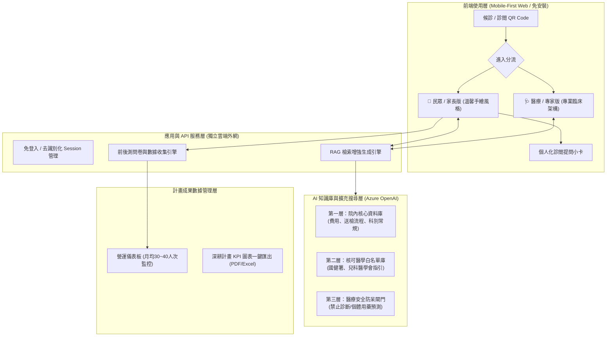

# 兒科次世代基因定序（NGS）智慧互動衛教系統
# 系統需求說明書 (System Requirements Specification, SRS)

| 文件版本 | 發布日期 | 臨床指導 | 撰寫單位 | 適用計畫 | 文件狀態 |
| :--- | :--- | :--- | :--- | :--- | :--- |
| **v1.0 (Draft)** | 2026-11-09 | 兒童遺傳專科 王禹期醫師 | 醫療系統整合規劃團隊 | 健康台灣深耕計畫專案 | 正式開發規格書 |

---

## 一、 專案概述 (Project Overview)

### 1.1 專案背景與目的
次世代基因定序（Next-Generation Sequencing, NGS）已成為兒科精準醫療（包含罕見疾病、發展遲緩、小兒神經、心臟、腎臟及眼科視神經病變等）之重要診斷工具。然而，臨床門診常面臨**「衛教觀念艱澀、家長焦慮困惑、自費/給付範圍混淆、醫師重複衛教耗損門診量能」**等痛點。

本專案旨在建置一套**獨立於醫院內網（免串接 HIS/EMR）、免安裝之 Mobile-First 互動式衛教 Web 系統**。民眾與家長可於診間外及候診區掃描 QR Code 使用，系統提供：
1. **雙軌分流內容**：溫馨易讀的「民眾/家長版」與具醫學深度的「醫療/專家版」。
2. **檢索增強型 AI 諮詢小幫手（RAG 架構）**：結合微軟 Azure OpenAI 雲端技術，採用「三層白名單搜尋」機制，零幻覺且能自動擴充醫學知識。
3. **醫病共享決策（SDM）前後測與診間提問卡**：評估健康識能提升率，並產出提問摘要供診間溝通。
4. **計畫成果數據管理後台**：自動統計每月服務量（約 30～40 人次）、前後測識能數據及滿意度，提供「健康台灣深耕計畫」期末結案報告所需之完整量化佐證。

### 1.2 系統目標使用者與使用場景
* **使用者族群**：
  * **兒科候診病患家長**：神經科、心臟科、腎臟科、眼科及成人科轉介之兒童個案家長。
  * **門診醫師與衛教護理師/個管師**：快速掌握家長核心疑慮、引導進一步諮詢與簽署同意書。
  * **計畫主持人/研究助理**：後台監控數據、匯出深耕計畫結案成效圖表。
* **主要使用情境**：
  * 候診時間（約 10～30 分鐘）：手機掃描 QR Code 進入「民眾版」，完成衛教卡片瀏覽、AI 提問與認知前後測，生成「提問小卡」。
  * 診間溝通（約 3～5 分鐘）：醫師參閱提問小卡，快速切中問題，縮短初階重複說明時間。
  * 轉介與內部溝通：年輕住院醫師或轉介科別醫師透過「專家版」查詢送檢指引與 Panel 規範。

---

## 二、 總體系統架構 (System Architecture)

---

## 三、 功能模組詳細規格 (Functional Requirements)

### 3.1 模組一：雙軌衛教瀏覽模組 (Public vs. Expert Track)

#### 【A 軌：🌸 民眾 / 家長版】
1. **溫馨視覺規範**：
   * 配色：暖杏黃、薄荷藍、粉桃橘等柔和馬卡龍色調。
   * 風格：大量採用圓角卡片（Rounded Cards）、手繪風格兒科插圖（小熊醫師、溫暖家庭、擬人化 DNA）。
2. **核心衛教卡片單元**：
   * **單元 1：什麼是 NGS？** 白話解說次世代基因定序（比喻：「全方位檢查身體的遺傳說明書」）。
   * **單元 2：檢測三大好處** 提早找出罕見病因、量身打造治療方案、提早預防遺傳併發症。
   * **單元 3：採檢流程與安全性** 圖解「抽血採檢 $\rightarrow$ 實驗室分析 $\rightarrow$ 專科門診解說」，強調安全性與痛感等同一般抽血。
   * **單元 4：費用與給付說明** 清楚條列健保給付範圍、全自費項目（如 WES/Trio）及院內/基金會補助諮詢管道。
   * **單元 5：檢測的局限性（知情同意）** 誠實說明檢測可能找不出原因，或有未確定意義變異（VUS），減少認知落差。
3. **影音與圖文整合**：支援嵌入科部 1~2 分鐘衛教短影片或動畫播放。

#### 【B 軌：🩺 醫療 / 專家版】
1. **切換機制**：首頁右上角設有「醫師 / 專業人員模式」切換開關（可設定簡單防誤觸確認）。
2. **專業衛教與臨床指引**：
   * **適應症指引**：涵蓋小兒神經（癲癇、腦性發育）、心臟（心肌病變、先天性心臟病）、腎臟（多囊腎、腎小管異常）、眼科（視神經萎縮、視網膜失養）。
   * **檢測規格標準**：Trio-WES、Targeted Gene Panel、CNV 分析技術規格說明。
   * **臨床送檢 SOP**：檢體採檢條件（EDTA 血液管、運送溫度）、外送流程與檢驗週期。
   * **表單範本**：提供數位化檢測申請單、病患知情同意書（ICF）、評估量表 PDF 預覽與下載連結。

---

### 3.2 模組二：檢索增強型 AI 諮詢小幫手 (RAG Q&A Engine)

採用微軟 Azure OpenAI 服務，結合向量資料庫（Vector DB）建置專屬 RAG 引擎：

1. **三層搜尋防護架構**：
   * **第一層（院內專屬核心庫 - 絕對優先）**：儲存醫師提供的衛教資料、收費標準、送檢天數。
   * **第二層（白名單知識擴展 - 授權擴大搜尋）**：預載衛福部國民健康署罕見疾病資料庫、台灣兒科醫學會臨床指引、GeneReviews 疾病百科。當院內資料未涵蓋背景醫學名詞時，系統可自動調用權威白名單回答，免除醫師撰寫百科全書的負擔。
   * **第三層（安全防呆閘門）**：針對「個人化用藥指導」、「死亡率/預後預測」等具法律風險之提問，強制啟動拒絕回答模組，並引導：「此問題涉及個體臨床狀況，請於入診時向主治醫師提出討論」。
2. **互動介面設計**：
   * **快捷推薦按鈕**：「需要空腹抽血嗎？」、「費用大約多少？」、「報告幾天會出來？」、「檢查很痛嗎？」。
   * **自然語言輸入框**：支援中文白話文輸入、語音輸入（瀏覽器原生支援）。
3. **資料自動化匯入機制（醫師友善）**：
   * 支援後台直接上傳 Word、PDF 或文字筆記，後台排程自動向量化（Chunking & Embedding），幾分鐘內完成知識庫更新。

---

### 3.3 模組三：互動式問卷與醫病共享決策 (SDM) 提問卡

1. **前測認知調查（掃碼進入時）**：
   * 1~2 題基本觀念檢測（例：「您是否知道 NGS 可以一次比對多個基因？」）。
2. **後測與滿意度調查（瀏覽完畢後）**：
   * 3 題前後比對認知題（計算健康識能提升率）。
   * 1 題整體易懂度與滿意度評分（1~5 星）。
3. **個人化「診間提問小卡 (Summary Card)」**：
   * 問卷完成後，引導家長勾選「我今天最想問醫師的事情」（費用、補助、報告時間、抽血風險...）。
   * 系統即刻於手機螢幕生成精美的「提問摘要卡」，提示家長：「進診間時，請出示這張卡片給醫師看，溝通更快速！」。

---

### 3.4 模組四：深耕計畫成果數據後台 (Analytics & Report Engine)

1. **營運指標監控（對齊每月 30～40 人次基線）**：
   * 總瀏覽人次、問卷填答完成率、平均停留時間。
   * 科別來源追蹤：透過不同 QR Code 參數（例：`?dept=neuro`、`?dept=cardio`、`?dept=nephro`、`?dept=ophtha`）統計各專科使用量。
2. **深耕計畫 KPI 成果統計**：
   * **健康識能提升率**：自動統計「衛教後正確率 $-$ 衛教前正確率」。
   * **滿意度統計**：4 星以上滿意比例。
   * **高頻關注議題排行**：彙整家長在 AI 小幫手最常詢問的關鍵字（提供科部科研或政策撰寫參考）。
3. **結案報表一鍵匯出**：
   * 支援匯出符合計畫成果報告格式的統計圖表（PNG/JPG）與匿名原始數據（Excel/CSV）。

---

## 四、 非功能性需求 (Non-Functional Requirements)

### 4.1 資訊安全與個資法規遵循 (Security & Compliance)
* **完全去識別化（Zero PII）**：系統端**絕對不蒐集、不儲存**病歷號、身分證字號、真實姓名、電話與出生年月日。
* **網路架構隔離**：系統全數部署於外部公有雲（Azure Taiwan / GCP Taiwan），與醫院內部 HIS 網路完全實體/邏輯隔離，免除院內資安防火牆審查瓶頸。
* **傳輸安全**：全站強制採用 HTTPS (TLS 1.3) 加密傳輸。
* **AI 隱私防護**：使用 Azure OpenAI 企業專屬執行個體，病患問答內容絕不用於公開模型訓練。

### 4.2 系統效能與可用性 (Performance & Usability)
* **載入速度**：首次頁面載入（FCP）於 4G/5G 行動網路環境下小於 2 秒。
* **AI 回應時間**：RAG 檢索生成回應時間（First Token Latency）小於 1.5 秒。
* **跨平台相容性**：全面支援 iOS Safari、Android Chrome、LINE 內建瀏覽器等各版本原生開啟。

---

## 五、 開發技術棧選型 (Tech Stack)

| 層級 | 推薦技術棧 | 選擇理由 |
| :--- | :--- | :--- |
| **前端框架** | Next.js (React) + TypeScript | 高效能 SSR/SSG、SEO 友善、行動端流暢渲染。 |
| **樣式設計** | Tailwind CSS + Lucide Icons | 快速打造自訂溫馨馬卡龍圓角風格與兒科插畫版面。 |
| **後端與 API** | Node.js (Next.js API Routes) | 輕量、快速開發、維護單一程式碼庫。 |
| **AI 與向量資料庫** | Azure OpenAI (GPT-4o mini) + pgvector / Pinecone | 微軟技術背書、低成本、高回應速度、知識庫檢索精確。 |
| **資料儲存** | PostgreSQL (Supabase / Azure Database) | 儲存去識別化之問卷紀錄、後台統計指標。 |
| **雲端部署** | Vercel 或 Azure App Service | 支援自動擴展、具高 SLA、免自架維運伺服器。 |

---

## 六、 驗收指標與深耕計畫 KPI 對照清單 (Verification Matrix)

本系統驗收時需符合下列深耕計畫對接指標：

| 指標類別 | 指標名稱 | 驗收標準 / 預期成果目標 |
| :--- | :--- | :--- |
| **服務量能** | 系統使用涵蓋率 | 上線後每月累積使用達 25 人次以上（佔月均 30~40 人次之 70%）。 |
| **健康識能** | 識能提升百分比 | 衛教後測認知答對率較前測**提升 30% 以上**。 |
| **滿意度** | 家長衛教滿意度 | 問卷調查滿意度達 **85% 以上**。 |
| **臨床效益** | 醫師時間節省度 | 透過診間小卡輔助，初階重複衛教時間縮短 **30%（約 5~8 分鐘/人）**。 |
| **專科覆蓋** | 跨專科服務應用 | 涵蓋**神經、心臟、腎臟、眼科** 4 大專科衛教內容。 |
| **報告產出** | 計畫結案輔助 | 後台可產出視覺化成果報告，供深耕計畫期末核銷。 |

